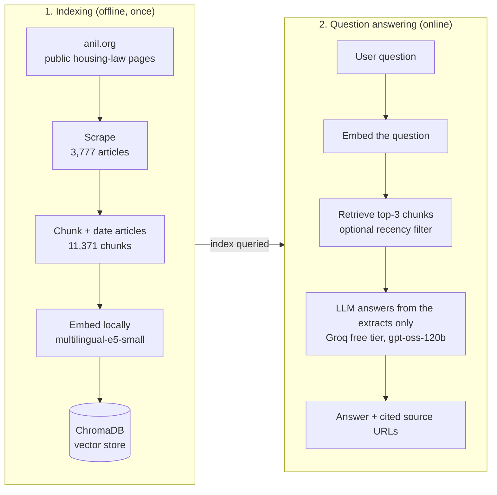

# French Rental-Law RAG: cited answers from official sources

Tenants and landlords often face precise legal questions: how large can a security deposit be, how much notice is required, when can the rent be raised? General-purpose LLMs answer them confidently, but not always correctly, and sometimes even cite laws that do not exist.

This project builds a retrieval-augmented generation (RAG) assistant that answers questions about residential rentals only from the official documentation of the [ANIL](https://www.anil.org), the French national housing information agency, and cites the page behind each claim.

On a 40-question benchmark, answering from these sources raises the average score from 54 % to 68 % and reduces the number of answers containing a hallucination from 111 to 5 (out of 120).

I built it during a CentraleSupélec client project for a French legal-tech startup, from October 2025 to June 2026.

**Who this page is for**

- **Recruiters**: read [Results](#results-rag-vs-no-retrieval-on-40-legal-questions) and [My contribution](#my-contribution).
- **Developers**: go to the [Quickstart](#quickstart-run-it-for-free), then the [detailed documentation](#detailed-documentation).
- **RAG practitioners**: see [How the pipeline works](#how-the-pipeline-works) and [Limits of the evaluation](#limits-of-the-evaluation).

**Jump to:** [Results](#results-rag-vs-no-retrieval-on-40-legal-questions) · [Architecture](#how-the-pipeline-works) · [Example](#example-question-answer-sources) · [Installation](#quickstart-run-it-for-free) · [Configuration](docs/configuration.md) · [Limits](#limits-of-the-evaluation)

## Results: RAG vs no retrieval on 40 legal questions

**How the benchmark works.** It contains 40 French rental-law questions, each with a reference answer and a 5-point grading rubric. Three free models (Groq free tier) answer every question in three modes, which gives 360 answers.

Retrieval uses local `multilingual-e5-small` embeddings over 11,371 ANIL chunks and returns the 3 closest ones. Each answer was graded blind against its rubric, losing one point per hallucination, and each configuration was run once.

| Model | No retrieval | RAG | RAG, sources ≥ 2014 | Hallucinations (no retrieval → RAG) | RAG refusals |
|-------|-------------:|----:|--------------------:|:-----------------------------------:|-------------:|
| gpt-oss-120b | 61.2 % | **68.8 %** | 64.8 % | 39 → 1 | 17.5 % |
| gpt-oss-20b | 42.0 % | **69.0 %** | 65.5 % | 36 → 4 | 10.0 % |
| qwen3.8-27b | 57.8 % | **66.8 %** | 64.5 % | 36 → 0 | 25.0 % |
| **Average** | 53.7 % | **68.2 %** | 64.9 % | **111 → 5** | 17.5 % |

*Refusals: answers stating that the retrieved extracts do not contain the answer, as the prompt requires.*

**Key findings**

- **Grounding removes almost all hallucinations.** Without retrieval, models invent article numbers, case law or figures in 111 of 120 answers; with retrieval, this drops to 5.
- **The gain is significant.** RAG adds +14.5 points on average (95 % bootstrap CI: +3.8 to +25.3). It wins on 25 questions, ties on 2 and loses on 13.
- **Small models catch up.** gpt-oss-20b goes from 42.0 % to 69.0 % and matches gpt-oss-120b.
- **Filtering by date does not help** (−3.3 points, not significant). An old article does not necessarily describe an outdated rule. On Q23, for instance, the only relevant source is a 2004 analysis, updated in 2011 and still valid; the filter removes it, and all three models drop from 5/5 to 0/5.

**Where RAG still fails.** Almost every loss comes from retrieval: the 3 retrieved chunks do not contain the answer, so the model says so. This happens mostly on multi-part questions (Q14, Q22, Q25, Q34, Q40).

The most promising next steps are a hybrid BM25 + vector search, breaking complex questions into sub-questions, or adding a reranker.

All 360 answers, with their sources and grades, are available in [`evaluation/results/`](evaluation/results/).

## Limits of the evaluation

- **Small test set.** With 40 questions, confidence intervals are wide (about 21 points for the RAG gain).
- **One run per configuration.** Each configuration was run once, so the variance across runs is unknown.
- **Team-written questions.** Questions and rubrics were written by the project team, which may favour what the corpus covers.
- **Single judge.** The published grades were produced by Claude (Opus 5.5) acting as judge, blind to model and mode, with the same rubric as the automated judge. The free Gemini tier allows only 20 requests a day, and the free Gemma endpoint was too often overloaded to grade 360 answers. The grades were not cross-checked by a human legal expert.
- **Narrow scope.** The benchmark covers only 3 free models and one embedding model.
- **One domain, one source.** The questions cover French housing law and the corpus comes only from the ANIL, so the results say nothing about other legal domains.
- **Frozen corpus.** The corpus is a snapshot from June 2026, so later changes in the law are not reflected.
- **Abstention is scored 0.** An honest answer saying that the extracts do not cover the question earns no points, just like a wrong answer.

## My contribution

The project was a team effort. This repository is my part of it, refactored after the project ended. The lists below separate what I built, what I tested, and the tools I used.

**What I developed**

- The ANIL scraper: concurrent crawler over 12 sections, text cleaning, resumable checkpoints.
- The hierarchical chunker, with a source header on every chunk and automatic article dating.
- The indexing and retrieval layer: local or API embeddings, ChromaDB vector store, optional recency filter.
- The grounded generation prompt: answer only from the extracts, cite the supporting URL, say so when the answer is missing.
- The evaluation harness: 40 questions with 5-point rubrics, hallucination penalty, runs that resume across free-tier quotas.

**What I tested**

- During the project: four Azure-hosted models, with and without retrieval, graded by a GPT-4o-mini judge.
- In October 2026: a full re-run on 3 free models × 3 modes (360 answers), shown above.
- An ablation of the recency filter, and an error analysis of the questions where RAG loses.

**Tools**

Python · ChromaDB · sentence-transformers (`multilingual-e5-small`) · OpenAI-compatible APIs (Groq, Gemini, Azure OpenAI) · BeautifulSoup · python-docx · pandas

## How the pipeline works



Four design choices make the pipeline reliable:

- **Hierarchical chunking.** A whole article stays in one chunk if it fits in 3,000 characters. Otherwise it is split by section, then by paragraph with a 500-character overlap.
- **Source headers.** Every chunk starts with its title, URL and section, so the model can always cite where a passage comes from.
- **Grounded prompt.** The model must answer only from the 3 retrieved extracts and cite their URLs, or state that the extracts do not answer the question.
- **Article dating.** Each article gets a year, which enables the optional recency filter (off by default, see [Results](#results-rag-vs-no-retrieval-on-40-legal-questions)).

## Example: question, answer, sources

```bash
python -m rag.ask "Quel est le montant maximal du dépôt de garantie en location vide et en location meublée ?"
```

```text
============================================================
REPONSE (gpt-oss-120b)
============================================================
Le montant maximal du dépôt de garantie est :

* **Location vide** : **un mois de loyer hors charges**【https://www.anil.org/parole-expert-logement-location-bail-meublee-vide/】, 【https://www.anil.org/parole-expert-logement-location-restitution-depot-garantie/】, 【https://www.anil.org/aj-contrats-types-de-location-de-logement-residence-principale/】.  
* **Location meublée** : **deux mois de loyer hors charges**【https://www.anil.org/parole-expert-logement-location-bail-meublee-vide/】, 【https://www.anil.org/parole-expert-logement-location-restitution-depot-garantie/】, 【https://www.anil.org/aj-contrats-types-de-location-de-logement-residence-principale/】.

============================================================
SOURCES (top 3)
============================================================

#1  similarite ~ 0.917
  article : Location : quelles sont les différences entre un bail meublé et non meublé ? (2025)
  url     : https://www.anil.org/parole-expert-logement-location-bail-meublee-vide/
  section : Pour le locataire

#2  similarite ~ 0.892
  article : Propriétaire-bailleur : quel délai pour restituer le dépôt de garantie ? (2022)
  url     : https://www.anil.org/parole-expert-logement-location-restitution-depot-garantie/
  section : Qu’est-ce que le dépôt de garantie ?

#3  similarite ~ 0.878
  article : Contrats types de location de logement à usage de résidence principale (2024)
  url     : https://www.anil.org/aj-contrats-types-de-location-de-logement-residence-principale/
  section : Garanties
```

This is the real, unedited output of gpt-oss-120b (Groq), with top-3 retrieval and `multilingual-e5-small` embeddings, run on 2026-10-17.

The answer is correct: one month of rent excluding charges for an unfurnished home, two months for a furnished one. The year shown next to each source title is the date of the article.

## Quickstart: run it for free

**Prerequisites:** Python 3.10+, about 2 GB of disk space, and a free [Groq API key](https://console.groq.com/keys), which requires no credit card. Retrieval runs locally and needs no key.

**1. Install**

```bash
git clone https://github.com/nicolas-potier/french-rental-law-rag.git
cd french-rental-law-rag
python -m venv .venv
source .venv/bin/activate          # Windows: .venv\Scripts\activate
pip install -r requirements.txt
```

**2. Set your API key**

```bash
cp .env.example .env               # then set GROQ_API_KEY=... in .env
```

**3. Build the index** (once)

```bash
python -m rag.chunk                # about 1 min
python -m rag.embed                # 15–45 min on a laptop CPU; add --max-chunks 500 for a quick test
```

**4. Ask a question**

```bash
python -m rag.ask "Quel est le montant maximal du dépôt de garantie en location meublée ?"
```

## Detailed documentation

| Document | Content |
|----------|---------|
| [docs/usage.md](docs/usage.md) | Every command and option, step by step: scraping, chunking, indexing, asking |
| [docs/configuration.md](docs/configuration.md) | Prerequisites, dependencies, environment variables, models and providers |
| [docs/evaluation.md](docs/evaluation.md) | Benchmark protocol, judge, commands, output files, how to reproduce or re-grade |

## Project background: from Azure to free models

During the project, the pipeline ran on the client's Azure OpenAI resource: ada-002 embeddings, four Azure-hosted models, and GPT-4o-mini as the judge.

That access ended with the project, so the original Azure runs cannot be reproduced. I refactored the code to run for free (local embeddings, free-tier models), while keeping the Azure configuration available.

The results on this page come from the October 2026 re-run, not from the original Azure benchmark.

## Data and license

The corpus is built from content published on [anil.org](https://www.anil.org); all rights to that content belong to the ANIL. It is included for research and demonstration only.

Answers produced by this system are not legal advice.
